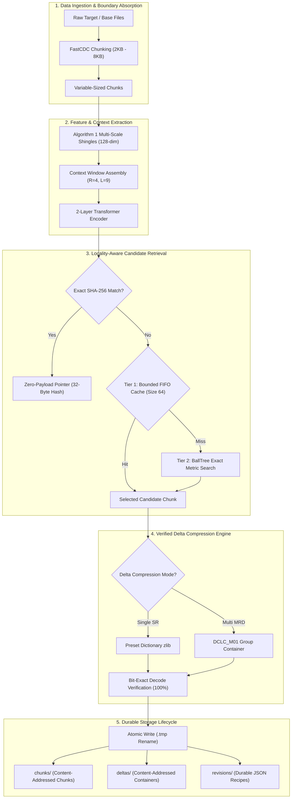
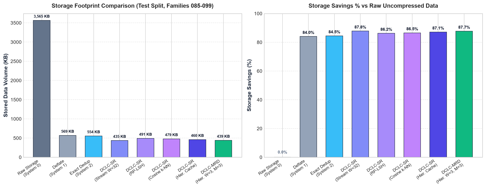
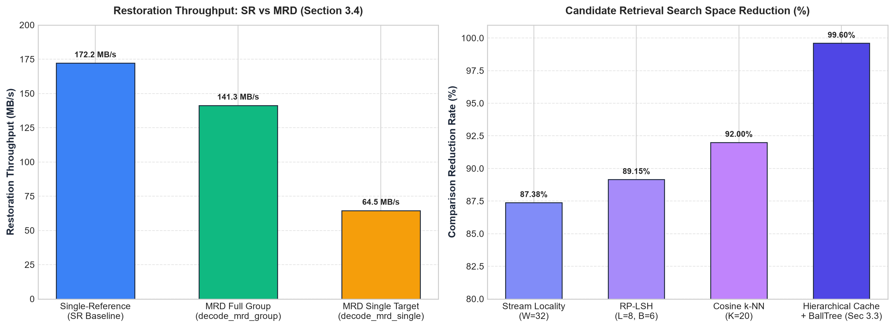

# DCLC: Deep Contrastive Learning–Based Redundancy Elimination for Cloud Storage Systems

[](https://www.python.org/)
[](https://fastapi.tiangolo.com/)
[](https://pytorch.org/)
[](https://react.dev/)
[]()

> Final Year Computer Science & Engineering Capstone Project  
> **Reference Paper:** Ling Xiao, Qinbao Fang, and Shihao Feng (2026). *“Deep contrastive learning–based redundancy elimination for similar data in cloud storage systems”*, Cluster Computing.  
> **DOI:** [10.1007/s44443-026-01042-5](https://doi.org/10.1007/s44443-026-01042-5)  
> **Repository:** [https://github.com/jasinthashankar/DCLC](https://github.com/jasinthashankar/DCLC)

---

## 1. Project Overview

Modern cloud repositories store massive volumes of multi-version data, such as software development revisions, virtual machine snapshots, and technical documents. While exact deduplication eliminates identical chunks, it is blind to **similar, non-identical data** that differs by minor modifications, additions, or local reorderings.

**DCLC** (Deep Contrastive Learning-based Redundancy Elimination) addresses this challenge through an end-to-end multi-stage pipeline:
1. **Content-Defined Variable Chunking:** FastCDC isolates modifications and absorbs boundary shifts.
2. **Multi-Scale Feature Extraction:** Algorithm 1 generates 128-dimensional byte-level shingle feature vectors.
3. **Context-Aware Transformer Representation:** A 2-layer Transformer encoder models spatial chunk sequences using self-attention.
4. **Contrastive Representation Learning:** Supervised InfoNCE loss trains the encoder to map resembling chunks close together in cosine embedding space.
5. **Locality-Aware Hierarchical Retrieval:** Combines a fast bounded FIFO cache (Tier 1) for stream-adjacent chunks with a tree-based nearest neighbor search (Tier 2).
6. **Delta Compression:** Supports both **Single-Reference (SR)** preset-dictionary delta compression and **Multi-Reference Delta (MRD)** neighborhood group encoding.
7. **Durable Storage Lifecycle:** Content-addressed chunk store, delta store, and atomic JSON recipes enabling restart-safe, byte-exact restoration.

---

## 2. Architecture Diagram



---

## 3. Empirical Research Results & Output Visualizations

Evaluated on the held-out test split (families 085–099, 464 chunks, 3.56 MB logical raw data):

| Architecture / System | Stored Bytes | Savings (%) | Compression Ratio | Accepted Deltas | Verified Bit-Exact |
| :--- | :---: | :---: | :---: | :---: | :---: |
| **System 0: Raw Storage** | 3,564,567 B | 0.00% | 1.00x | N/A | 100.0% |
| **System 1: Standalone Deflate** | 568,542 B | 84.05% | 6.27x | N/A | 100.0% |
| **System 2: Exact SHA-256 Dedup** | 554,325 B | 84.45% | 6.43x | N/A | 100.0% |
| **System 3A: DCLC-SR (Stream Locality W=32)** | 435,386 B | 87.79% | 8.19x | 426 deltas | 100.0% |
| **System 3B: DCLC-SR (RP-LSH L=8, B=6)** | 491,085 B | 86.22% | 7.26x | 377 deltas | 100.0% |
| **System 3C: DCLC-SR (Embedding k-NN K=20)** | 479,304 B | 86.55% | 7.44x | 434 deltas | 100.0% |
| **System 3D: DCLC-SR (Hierarchical Cache + BallTree)** | 459,858 B | 87.10% | 7.75x | 434 deltas | 100.0% |
| **System 4: DCLC-MRD (Hierarchical + MRD W=3)** | **439,173 B** | **87.68%** | **8.12x** | **153 groups** | **100.0%** |

### Output Visualizations & Benchmarks





---

## 4. Technology Stack

- **Backend Runtime:** Python 3.13.10 (64-bit Windows)
- **API Framework:** FastAPI 0.115+, Uvicorn ASGI server
- **Deep Learning Framework:** PyTorch 2.14+ (CPU / CUDA compatible)
- **Chunking Engine:** `fastcdc` official content-defined chunking library
- **Nearest Neighbor Indexer:** `scikit-learn` `BallTree` *(Exact metric tree search replacement for Annoy on Windows Python 3.13)*
- **Compression & Hashing:** Standard library `zlib` (preset dictionary compression), `hashlib` (cryptographic SHA-256)
- **Frontend Stack:** React 19.2, TypeScript 5.8+, Vite 8.3, Tailwind CSS v4, Lucide React icons
- **Automated Testing:** `pytest` (Python backend, 269 tests), `vitest` (Frontend units)

> [!NOTE]
> **Annoy vs. BallTree Architecture Note:**
> In the original paper, Annoy is suggested for Tier 2 approximate nearest neighbor search. In this implementation on Windows Python 3.13, we deploy `BallTree` over $L_2$-normalized unit vectors. For unit vectors, Euclidean distance $d$ and Cosine similarity satisfy $\text{cosine\_similarity} = 1 - \frac{d^2}{2}$. Unlike approximate graph/tree methods, `BallTree` guarantees 100% exact nearest neighbor retrieval without indexing approximations, perfectly suiting our evaluation scale.

---

## 5. Quickstart Guide

### Prerequisites
- Python 3.11+ (Python 3.13 tested)
- Node.js 18+ and npm
- Virtual environment activated (`.\.venv\Scripts\Activate.ps1`)

### 1. Start the FastAPI Backend
```powershell
.\.venv\Scripts\python.exe -m uvicorn api.main:app --host 127.0.0.1 --port 8000 --reload
```
Interactive API Swagger documentation is available at `http://127.0.0.1:8000/docs`.

### 2. Start the React Frontend
```powershell
cd frontend
npm install
npm run dev
```
Open `http://localhost:5173` in your browser.

### 3. Run the Research Evaluation Benchmark
```powershell
.\.venv\Scripts\python.exe -m scripts.run_research_evaluation
```
Outputs:
- `reports/research_evaluation_results.json`
- `reports/research_evaluation_report.md`

### 4. Run the Full Test Suite
```powershell
.\.venv\Scripts\python.exe -m pytest -q
```
*Current test count: 269 passed (0 failures).*

---

## 6. REST API Endpoints

| Method | Route | Description |
| :--- | :--- | :--- |
| `GET` | `/health` | Service status, model checkpoint, and device availability. |
| `POST` | `/chunk-preview` | FastCDC chunking and SHA-256 fingerprinting. |
| `POST` | `/compare-revisions` | Differential compression with SR / MRD modes. |
| `GET/POST`| `/benchmark-storage` | Comparative benchmark across held-out test families. |
| `POST` | `/store-revision` | Persist revision recipe, chunks, and deltas atomically. |
| `GET` | `/revisions` | List all persisted revision manifests. |
| `GET` | `/revisions/{id}` | Retrieve full chunk recipe manifest for revision. |
| `GET` | `/restore-revision/{id}` | Reconstruct target file from disk and verify SHA-256. |
| `GET` | `/download-restored/{id}` | Stream restored binary file as attachment download. |

---

## 7. Project Structure

```text
DCLC/
├── api/                        # FastAPI REST API layer
│   ├── main.py                 # Endpoint definitions & route handlers
│   ├── schemas.py              # Pydantic request/response models
│   └── service.py              # Service coordination layer
├── src/                        # Core algorithmic research modules
│   ├── fastcdc_chunker.py      # FastCDC variable-sized chunking
│   ├── initial_feature_extractor.py # Algorithm 1 multi-scale shingle hashing
│   ├── context_builder.py      # Context window assembler
│   ├── model.py                # 2-layer Transformer Context Encoder
│   ├── candidate_indexer.py    # Hierarchical Cache + BallTree, LSH, k-NN
│   ├── delta_encoder.py        # SR and Multi-Reference Delta (MRD) engines
│   ├── storage_manager.py      # Content-addressed chunk/delta persistence
│   └── pipeline_evaluator.py   # Benchmark evaluation runner
├── frontend/                   # Modern React 19 UI
│   ├── src/components/         # RevisionsSection, CompareFilesSection, etc.
│   └── src/services/api.ts     # TypeScript API client
├── tests/                      # Automated test suite (269 tests)
│   ├── test_phase_d_validation.py # Pipeline edge case validation
│   └── test_phase_e_persistence.py# Durable persistence & recovery tests
├── reports/                    # Empirical evaluation reports and demo guides
│   ├── research_evaluation_report.md
│   ├── dclc_final_research_report.md
│   └── hod_demo_guide.md
├── assets/                     # Visualizations and benchmark charts
│   ├── dclc_evaluation_results.png
│   └── dclc_mrd_tradeoff.png
└── scripts/                    # Evaluation and benchmarking scripts
    └── run_research_evaluation.py
```

---

## 8. Authors & Acknowledgments

- **Student Developer:** Jasintha Shankar (Final-Year CSE)
- **Faculty Guide / Reviewer:** Department of Computer Science & Engineering
- **Academic Citation:** Xiao, L., Fang, Q., & Feng, S. (2026). Deep contrastive learning–based redundancy elimination for similar data in cloud storage systems. *Cluster Computing*.
