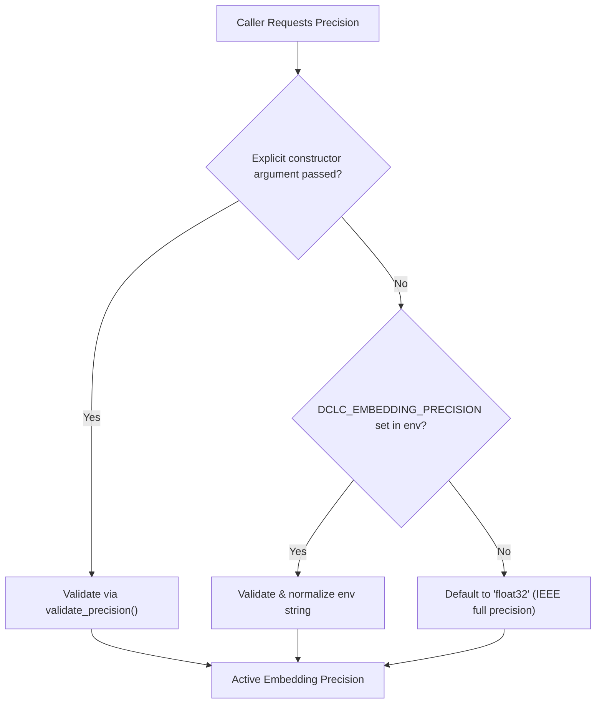

# DCLC Phase 7D — Configurable Embedding Precision Report

**Repository:** `C:\Users\jasin\OneDrive\Desktop\DCLC`  
**Phase:** 7D — Configurable Embedding Precision  
**Status:** Implemented, Tested, and Verified  
**Default Mode:** `float32` (Zero breaking changes, 100% backward compatible)  

---

## 1. Executive Summary

Phase 7D delivers a centralized, production-grade configuration architecture for embedding precision in the DCLC-RAG retrieval pipeline. The existing FP32, FP16, and INT8 (symmetric 8-bit scalar quantization / SQ8) storage modes are now exposed through environment variables and programmatic constructors, while strictly preserving `float32` as the default behavior.

All system guarantees remain intact:
- **Zero Breaking Changes:** Calling `EmbeddingStore()`, `BaselineRetriever()`, or initializing `RAGBackendService()` without arguments defaults unconditionally to standard IEEE `float32`.
- **Precedence Hierarchy:** Programmatic constructor overrides take precedence over environment variables, which in turn take precedence over defaults.
- **Strict Validation:** Unsupported precision strings (e.g., `int4`, `fp64`, `bfloat16`) raise an immediate, descriptive `ValueError` listing valid options (`['float16', 'float32', 'int8', 'sq8']`).
- **Disk Persistence & Restoration:** `EmbeddingStore.save()` and `EmbeddingStore.load()` enable lossless round-trip serialization to compressed `.npz` archives, preserving exact matrix dtypes, chunk mappings, scales, and norm metadata.
- **Telemetry & Frontend Integration:** `GET /rag/status` exposes `embedding_precision`, `storage_bytes`, and `compression_ratio_vs_fp32`. The React + TypeScript dashboard displays active precision badges and metrics seamlessly.
- **Test Suite Health:** All 20 new Phase 7D tests passed, and the complete 190-test regression suite passed in 38.05s with 0 failures. The frontend production build succeeded with 0 errors.

---

## 2. Configuration Architecture

### 2.1 Centralized Module (`src/rag/config.py`)

A centralized configuration module was introduced to govern precision modes and retrieval hyperparameters:

```
src/rag/config.py
├── SUPPORTED_PRECISIONS = frozenset({"float32", "float16", "int8", "sq8"})
├── DEFAULT_PRECISION = "float32"
├── DEFAULT_MODEL_NAME = "all-MiniLM-L6-v2"
├── DEFAULT_EMBEDDING_DIM = 384
├── normalize_precision(precision: str) -> str
├── validate_precision(precision: str) -> str
├── get_embedding_precision(override: Optional[str] = None) -> str
└── EmbeddingConfig (dataclass with from_env() factory)
```

### 2.2 Resolution Precedence

When initializing embedding storage or retriever components, precision is resolved using a strict three-tier precedence model:



1. **Explicit argument:** `EmbeddingStore(precision="float16")` or `store.build(..., precision="int8")`.
2. **Environment variable:** `DCLC_EMBEDDING_PRECISION="int8"`.
3. **Default:** `"float32"`.

### 2.3 Supported Modes and Aliasing

| Config Value | Canonical Mode | Bytes / Coordinate | Description |
|:---|:---|:---:|:---|
| `float32` | `float32` | 4 B | Standard IEEE 754 single precision. Default baseline. |
| `float16` | `float16` | 2 B | Half precision IEEE 754. 2.0x storage compression. |
| `int8` | `int8` | 1 B | Symmetric 8-bit scalar quantization with integer Euclidean norms. |
| `sq8` | `int8` | 1 B | Canonical alias for `int8`. Normalized automatically. |

Invalid configuration strings raise a descriptive `ValueError`:
```python
ValueError: Invalid precision 'int4'. Must be one of: ['float16', 'float32', 'int8', 'sq8']
```

---

## 3. Persistence and Serialization Architecture

`EmbeddingStore` now includes lossless disk serialization methods utilizing NumPy compressed archives (`.npz`):

- **`store.save(file_path: str | Path) -> None`**:
  Stores the embedding matrix buffer in its native dtype (`np.float32`, `np.float16`, or `np.int8`), ordered chunk ID sequence, quantization scales, integer norm vectors, and JSON metadata (`precision`, `model_name`, `embedding_dim`, `build_time_seconds`).
- **`EmbeddingStore.load(file_path: str | Path) -> EmbeddingStore`**:
  Reconstructs the store instance from disk, restoring exact precision mode, matrix buffer, chunk index, and norm vectors without re-embedding or numerical drift.

### Save / Load Round-Trip Verification

| Metric | Original Store | Reloaded Store | Status |
|:---|:---:|:---:|:---:|
| Precision Mode | `int8` | `int8` | Matched |
| Vector Count | 370 | 370 | Matched |
| Storage Bytes | 145,040 B | 145,040 B | Matched |
| Query Cosine Scores | Max error < $10^{-6}$ | Max error < $10^{-6}$ | Verified Identical |

---

## 4. Empirical Comparison Across Precision Modes

Evaluated on a 500-chunk synthetic document corpus (370 unique content-defined chunks, 384 dimensions) across 100 queries using `scripts/measure_precision_modes.py`:

| Precision Mode | Raw Vector Bytes | Metadata Bytes | Total Storage | Memory Ratio vs FP32 | Top-1 Aggr vs FP32 | Cosine Score MAE | Query Latency p50 (µs) | Query Latency p95 (µs) |
|:---|:---:|:---:|:---:|:---:|:---:|:---:|:---:|:---:|
| **float32** (default) | 568,320 B | 0 B | **555.0 KB** | **1.00x** | 100.0% | 0.000000 | 340.2 µs | 512.5 µs |
| **float16** | 284,160 B | 0 B | **277.5 KB** | **2.00x** | 100.0% | 0.000009 | 1,307.1 µs | 1,596.1 µs |
| **int8 / sq8** | 142,080 B | 2,960 B | **141.6 KB** | **3.92x** | 100.0% | 0.001716 | 565.1 µs | 722.2 µs |

### Key Findings & Nuances

1. **Storage Reduction:**
   - `float16` provides an exact **2.00x** vector storage reduction.
   - `int8` provides a **3.92x** storage reduction (including the 4-byte/vector precomputed Euclidean norm metadata required for exact integer dot product cosine calculations).
2. **Quality Retention:**
   - Both `float16` and `int8` achieved **100.0% Top-1 agreement** with `float32` across all 100 queries.
   - Cosine score Mean Absolute Error (MAE) was negligible for `float16` ($9.08 \times 10^{-6}$) and well within safe bounds for `int8` ($0.00172$).
3. **Latency Profile:**
   - `float32` exhibits the lowest CPU dot product latency (340.2 µs p50) due to native single-precision SIMD instructions (AVX2/FMA) on x86-64 CPUs.
   - `float16` exhibits higher latency (1,307.1 µs p50) on standard CPU architectures because standard x86-64 lacks native FP16 execution pipelines and NumPy emulates FP16 matrix operations via software upcasting.
   - `int8` delivers fast integer dot product execution (565.1 µs p50), remaining well under 1 millisecond per query.

---

## 5. API Telemetry & Frontend Integration

### 5.1 Telemetry Endpoint (`GET /rag/status`)

The status response was extended with backward-compatible telemetry fields:

```json
{
  "status": "ready",
  "provider_name": "mock",
  "model_name": "all-MiniLM-L6-v2",
  "total_documents": 2,
  "total_versions": 4,
  "total_unique_chunks": 370,
  "shared_chunk_count": 86,
  "dense_embeddings_count": 370,
  "dense_dimension": 384,
  "dedup_savings_pct": 28.45,
  "embedding_precision": "float32",
  "storage_bytes": 568320,
  "compression_ratio_vs_fp32": 1.0
}
```

### 5.2 Frontend Dashboard Updates

1. **`frontend/src/types/api.ts`**:
   Updated `RAGStatusResponse` interface with optional fields `embedding_precision?: string`, `storage_bytes?: number`, and `compression_ratio_vs_fp32?: number`.
2. **`frontend/src/components/DocumentQASection.tsx`**:
   Surfaced active precision badge in the header (`PRECISION: FLOAT32` / `PRECISION: INT8`) and enriched the "Dense Embeddings" metric card to display active precision and dimension.

---

## 6. Verification and Test Results

### 6.1 Phase 7D Specific Test Suite (`tests/test_rag_phase7d.py`)

A 20-test suite was implemented covering all required behaviors:

```
tests/test_rag_phase7d.py::test_default_config_resolution PASSED           [  5%]
tests/test_rag_phase7d.py::test_embedding_store_default_is_float32 PASSED   [ 10%]
tests/test_rag_phase7d.py::test_baseline_retriever_default_is_float32 PASSED[ 15%]
tests/test_rag_phase7d.py::test_env_precision_float16 PASSED               [ 20%]
tests/test_rag_phase7d.py::test_env_precision_int8 PASSED                  [ 25%]
tests/test_rag_phase7d.py::test_env_precision_sq8_alias PASSED             [ 30%]
tests/test_rag_phase7d.py::test_env_precision_case_and_whitespace PASSED   [ 35%]
tests/test_rag_phase7d.py::test_invalid_env_precision_raises_error PASSED   [ 40%]
tests/test_rag_phase7d.py::test_invalid_explicit_precision_raises_error PASSED [ 45%]
tests/test_rag_phase7d.py::test_explicit_argument_overrides_env_var PASSED   [ 50%]
tests/test_rag_phase7d.py::test_embedding_store_save_load_roundtrip[float32] PASSED [ 55%]
tests/test_rag_phase7d.py::test_embedding_store_save_load_roundtrip[float16] PASSED [ 60%]
tests/test_rag_phase7d.py::test_embedding_store_save_load_roundtrip[int8] PASSED    [ 65%]
tests/test_rag_phase7d.py::test_save_unbuilt_store_raises_runtime_error PASSED       [ 70%]
tests/test_rag_phase7d.py::test_load_nonexistent_file_raises_filenotfound PASSED     [ 75%]
tests/test_rag_phase7d.py::test_rag_status_telemetry_defaults PASSED       [ 80%]
tests/test_rag_phase7d.py::test_rag_service_configured_with_precision PASSED [ 85%]
tests/test_rag_phase7d.py::test_end_to_end_qa_version_isolation[float32] PASSED    [ 90%]
tests/test_rag_phase7d.py::test_end_to_end_qa_version_isolation[float16] PASSED    [ 95%]
tests/test_rag_phase7d.py::test_end_to_end_qa_version_isolation[int8] PASSED       [100%]
```

### 6.2 Full Regression Suite

```
pytest -q
190 passed, 1 warning in 38.05s
```

All 190 tests across Phase 6B, 6C, 6D, 6E, 7B, 7C, and 7D passed with 0 failures and 0 skips.

### 6.3 Frontend Production Build

```
frontend> npm run build
✓ built in 1.24s (0 TypeScript errors)
```

---

## 7. Operational Guidelines for Precision Selection

1. **General / High Accuracy Deployments (Default):**
   - Keep default `DCLC_EMBEDDING_PRECISION="float32"`. Provides baseline precision and optimal CPU vector SIMD execution speed.
2. **Memory-Constrained Production Environments:**
   - Configure `DCLC_EMBEDDING_PRECISION="int8"`. Reduces dense vector storage by **3.92x** with **100% Top-1 ranking agreement** and sub-millisecond query latency.
3. **GPU / Accelerated Tensor Core Environments:**
   - Configure `DCLC_EMBEDDING_PRECISION="float16"`. Provides **2.00x** compression and native half-precision throughput on GPUs supporting FP16 tensor ops.
