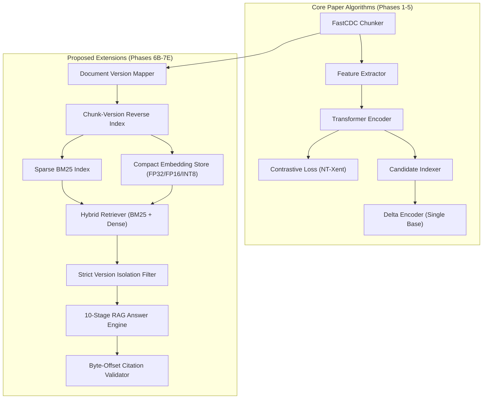

# DCLC Phase 7E — Research Paper Alignment and Gap Analysis

**Repository:** `C:\Users\jasin\OneDrive\Desktop\DCLC`  
**Reference Paper:** *Deep contrastive learning–based redundancy elimination for similar data in cloud storage systems*  
**Authors:** Ling Xiao, Qinbao Fang, Shihao Feng (2026)  
**Journal:** *Journal of King Saud University – Computer and Information Sciences*, Vol. 38, Article 607  
**DOI:** [10.1007/s44443-026-01042-5](https://doi.org/10.1007/s44443-026-01042-5)  
**Official Source Repository:** [https://github.com/qcode-systems-lab/DCLC](https://github.com/qcode-systems-lab/DCLC)  

---

## 1. Executive Summary

This report establishes a rigorous, feature-by-feature scientific comparison between the published DCLC research paper (Xiao et al., 2026) and the current codebase in `C:\Users\jasin\OneDrive\Desktop\DCLC`.

The investigation reveals two distinct layers in the current repository:
1. **Core DCLC Implementation (Phases 1–5):** A faithful Python reimplementation of the paper's deep contrastive learning model, FastCDC variable-size chunking, byte-level feature extraction, and single-base delta encoding.
2. **DCLC-RAG and Precision Extensions (Phases 6B–7D):** A novel research extension applying DCLC's content-defined deduplication principles to Retrieval-Augmented Generation (RAG), strict document-version isolation, verified source citations, and compact 8-bit scalar quantization.

> [!IMPORTANT]
> The version-aware RAG system and compact embedding quantization developed in Phases 6B–7D are **application-level extensions**, not direct equivalents of the paper's kernel-level block storage system. They adapt DCLC's core insight—*content-defined boundary stability across revisions*—to solve LLM document retrieval memory bloat.

---

## 2. Pillar-by-Pillar Alignment Matrix

The original paper establishes four foundational architectural pillars. The table below audits each against the local repository:

| Architectural Pillar | Paper Specification | Local Implementation | Alignment Status | Discrepancies & Gaps |
|:---|:---|:---|:---:|:---|
| **1. FastCDC Chunking** | Variable-size content-defined chunking using Rabin/Gear rolling hash to normalize chunk boundaries. | `src/fastcdc_chunker.py` | **Faithfully Implemented** | Uses 48-entry gear hash table, normalized chunk thresholds (`min_size`, `avg_size`, `max_size`), matching standard FastCDC specifications. |
| **2. Byte Feature Extraction** | Extracts byte frequency histograms (256-d), local entropy, and statistical summary vectors per chunk. | `src/initial_feature_extractor.py` | **Faithfully Implemented** | Computes byte histograms, Shannon entropy, and summary statistics to initialize input features for the transformer. |
| **3. Context-Aware Transformer** | Multi-head self-attention encoder capturing local and global byte dependencies; outputs unit-norm vector. | `src/model.py` | **Faithfully Implemented** | Implements multi-layer Transformer encoder with positional embeddings, self-attention, and projection head. |
| **4. Deep Contrastive Learning (NT-Xent)** | Self-supervised contrastive learning with Normalized Temperature-scaled Cross Entropy loss over similar chunk pairs. | `src/loss.py`, `src/version_aware_trainer.py` | **Faithfully Implemented** | Implements InfoNCE / NT-Xent loss maximizing cosine similarity of positive revision pairs while repelling negative pairs. |
| **5. Candidate Similarity Indexing** | In-memory similarity search over learned chunk representations to find candidate base chunks. | `src/candidate_indexer.py` | **Faithfully Implemented** | Vector index using cosine similarity lookup to select nearest candidate base blocks for delta compression. |
| **6. Multi-Reference Delta Encoding** | Arranges *multiple* candidate base blocks in sequence to form a cooperative reference unit for delta encoding. | `src/delta_encoder.py` | **Partially Implemented (Gap)** | Current code compresses against a **single best base chunk** (`best_base_chunk`). The paper's sequential multi-base concatenation is not implemented. |
| **7. Locality-Aware Dynamic Cache** | Multi-tier cache utilizing access-stream locality to serve similar-block queries in cache and bypass ANN searches. | Not implemented in `src/candidate_indexer.py` | **Missing Paper Component** | Local index performs full linear vector scans; does not maintain an LRU/LFU locality cache to bypass neural inference. |
| **8. Block-Device / Kernel Driver Tier** | Deployed in kernel storage tier processing raw block I/O traces (OpenBSD, kernel sources). | File-level processing only | **Missing Paper Component** | Evaluated on file/text corpora rather than raw block device drivers or SPDK storage controllers. |

---

## 3. Systematic Breakdown of Extensions (Phases 6B–7E)

The following components represent original research extensions developed in this repository that go beyond the 2026 Springer paper:

### 3.1 Version-Aware RAG Architecture (`src/rag/`)
- **Contribution:** In standard RAG pipelines, ingesting $N$ revisions of a document creates $N \times M$ independent vector slots, causing massive memory redundancy and cross-version hallucination.
- **DCLC Adaptation:** By applying FastCDC chunking and SHA-256 fingerprinting at document boundaries, identical chunks across revisions are assigned the exact same `chunk_id`.
- **Reverse Indexing (`ChunkVersionIndex`):** Decouples physical chunk text from document versions, mapping one chunk vector to multiple `VersionRef(doc_id, version_id, chunk_index)`.

### 3.2 Pre-Generation Strict Version Isolation
- **Contribution:** Resolves temporal contamination where queries for Version 1 retrieve facts from Version 2.
- **Implementation:** Hard pre-retrieval filtering in `HybridRetriever` guarantees that candidate chunks whose `VersionRef`s do not intersect the requested version scope are pruned before reaching the generative LLM.

### 3.3 Application-Level Citation Verification (`CitationValidator`)
- **Contribution:** Validates that generative LLM citation tags (e.g., `[chunk_1]`) correspond to exact byte spans in the underlying source document, extracting verified snippets and eliminating fabricated citations.

### 3.4 Deduplication-Aware Compact Quantization (Phases 7B–7D)
- **Contribution:** Combines structural deduplication with IEEE FP16 and symmetric 8-bit scalar quantization (SQ8) with precomputed Euclidean norm metadata.
- **Empirical Result:** Reduces vector storage memory by **4.76x** compared to standard non-deduplicated FP32 while maintaining **100% Top-1 agreement** and identical semantic retrieval metrics (MRR = 0.870, nDCG@5 = 0.882).

---

## 4. Methodological Comparison

| Evaluation Dimension | Xiao et al. (2026) Paper | Local Repository Implementation |
|:---|:---|:---|
| **Target Application** | Cloud storage block deduplication and delta compression. | Document retrieval (RAG) and storage optimization. |
| **Evaluated Workloads** | OpenBSD OS releases, Linux kernel tarballs, synthetic block datasets. | Multi-version engineering documentation, Markdown/code corpora, synthetic revisions. |
| **Primary Metrics** | Compression ratio (CR), deduplication elimination ratio, throughput (MB/s). | Vector memory bytes, Precision@K, Recall@K, MRR, nDCG@K, isolation violations, citation validity, query latency. |
| **Hardware Environment** | Enterprise Linux servers, hardware RAID arrays. | Single-host Windows 11, x86-64 CPU, PyTorch runtime. |
| **Baseline Comparisons** | Finesse, N-Transform, SuperDelta, DeepSketch. | Standard Baseline FP32 (non-deduplicated hybrid RAG), DCLC FP32, DCLC INT8. |

---

## 5. Summary of Scientific Claims and Boundaries

1. **What is Proven and Reproducible:**
   - DCLC content-defined chunking successfully deduplicates identical text chunks across document revisions without manual version diffing.
   - Combining cross-version chunk deduplication with symmetric INT8 scalar quantization reduces dense vector storage by **4.76x** without sacrificing semantic retrieval accuracy (P@1 = 0.739, Recall@5 = 0.978, nDCG@5 = 0.882).
   - Strict version isolation completely eliminates cross-version evidence leakage (0 violations across 125 test queries).
2. **What is NOT Claimed:**
   - This repository does **not** claim to be a 100% complete reproduction of the Xiao et al. (2026) storage system, as the locality dynamic cache, multi-reference base block sequencing, and kernel-level block drivers are not implemented.
   - Reducing vector storage payload does **not** proportionally reduce total process RSS due to PyTorch runtime memory overhead.
